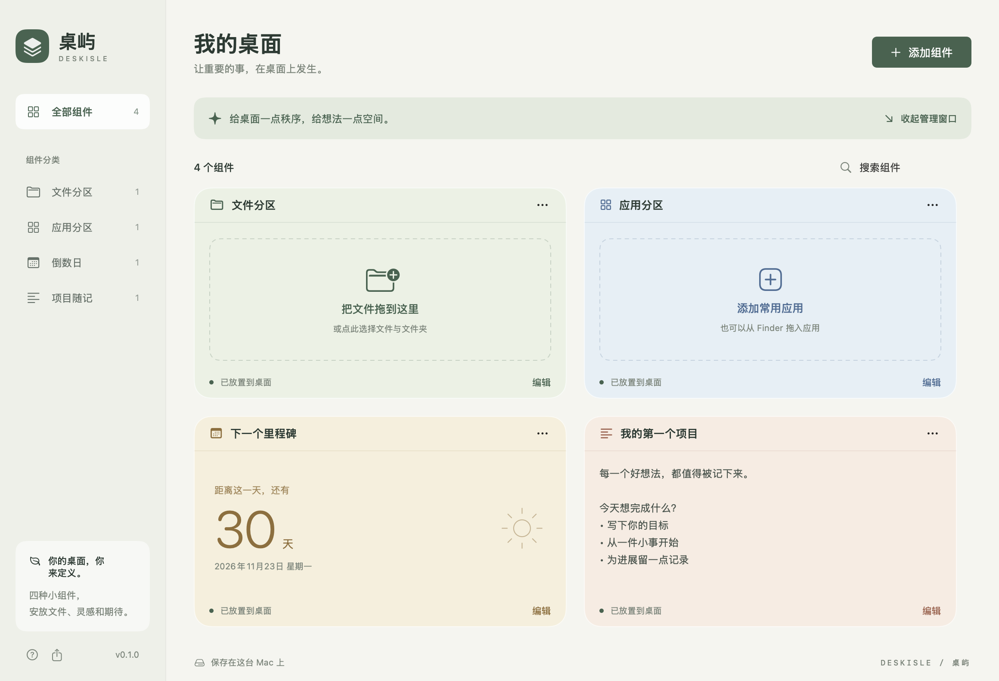

# 桌屿 · DeskIsle

一个可在 Mac 上直接运行的原生桌面组件应用，首版围绕文件分区、应用分区、倒数日和项目随记展开。使用 SwiftUI + AppKit 独立实现，参考 DeskWidget 的功能方向，没有使用它的代码或图片资产。



## 仓库存档

源码、测试、资源与开发文档在当前仓库中。Apple Silicon 可运行压缩包见 [DeskIsle v0.1.0](releases/DeskIsle-v0.1.0-macOS-arm64.zip)，下载后解压并打开 `DeskIsle.app`。校验值见 [SHA256SUMS](releases/SHA256SUMS)。编译缓存与本地 `dist/` 输出不纳入 Git。

## 打开应用

构建好的程序在 `dist/DeskIsle.app`，在 Finder 中双击打开即可。也可以运行：

```sh
open dist/DeskIsle.app
```

应用常驻菜单栏。关闭管理窗口后桌面组件继续显示，点菜单栏的叠层图标可以重新打开管理窗口，或显示/隐藏全部组件。退出请使用菜单栏的「退出桌屿」。

## 已实现

- **文件分区**：添加文件和文件夹，支持 Finder 拖入、原生图标、点击打开、右键访达定位、移除引用。保存文件书签，尽可能跟踪文件重命名或移动；若书签无法解析，则回退到保存的路径。引用失效时提示重新添加。文件始终保留在原位置。
- **应用分区**：选择或拖入 `.app`，显示原生图标、点击启动，可创建多个分组。
- **倒数日**：编辑名称和目标日期，按本地日历计算天数，当天显示零，过期后显示已经走过的天数，每分钟刷新。
- **项目随记**：在桌面卡片直接输入普通文本，或在编辑面板内输入，自动保存。
- **桌面摆放**：每个组件是独立桌面窗口。拖动顶部移动，拖动边缘调整尺寸，支持锁定位置、始终置顶、隐藏与删除。
- **管理界面**：分类、搜索、多实例、四种配色、原生编辑面板。
- **本地保存**：原子写入，保留上一份有效备份，退出前刷新未保存内容，支持导出 JSON 备份。损坏数据或更高版本数据会被保留，应用进入只读状态并提示路径。

## 数据与备份

正式数据：`~/Library/Application Support/DeskIsle/workspace.json`。上一份有效数据：`workspace.json.backup`。随记输入停止约 0.45 秒后保存。测试模式使用 `/private/tmp/DeskIsle-Smoke/`，与正式数据隔离。

左下角导出按钮或菜单栏「导出数据备份」会保存当前布局、文本、日期与引用。**备份不包含被引用文件本体**。首版没有图形化导入；如需恢复，请先退出桌屿，保留现有 JSON，再将备份复制为上述正式路径的 `workspace.json`，最后重新启动。

删除项目随记组件会删除其文本，删除前会有确认。删除文件/应用组件或移除引用不会删除源文件。应用不联网、不接入账号，也不读取 DeskWidget 用户数据。

## 从源码构建

需要 macOS 14+ 和 Apple Command Line Tools（含 Swift）。不需要第三方依赖或完整 Xcode 工程。

```sh
./build.sh
./test.sh
```

`build.sh` 自动按当前电脑架构构建并进行本地 ad-hoc 签名。当前交付是 Apple Silicon / arm64 构建。脚本针对本机 Swift 6.3 与默认 SDK 27 不匹配的环境，使用已安装的 SDK 26.5；不改动系统 SDK 配置。也可在兼容的开发环境中重建。

`Sources/` 包含数据模型、数据存储、组件视图、管理界面和 AppKit 窗口管理。`Resources/GenerateIcon.swift` 为本项目绘制独立图标。

## 首版边界

这是本地可用的 0.1.0 开发版：未做 Developer ID 公证与 App Store 发布；当前只在这台 Apple Silicon Mac 上验证。采用可自由交互的 AppKit 桌面窗口，不是系统 WidgetKit 组件。项目随记目前是普通文本；尚未加入富文本、iCloud 同步、登录时自动启动、目录内容自动映射、网格吸附和农历重复倒数日。桌面层组件位于普通应用窗口下方，可以通过 macOS 的「显示桌面」查看，或将单个组件设置为始终置顶。

参考分析和证据见 `docs/DeskWidget-reference.md`、`docs/rea-evidence.json`。实际运行验证记录见 `docs/Validation.md`。
